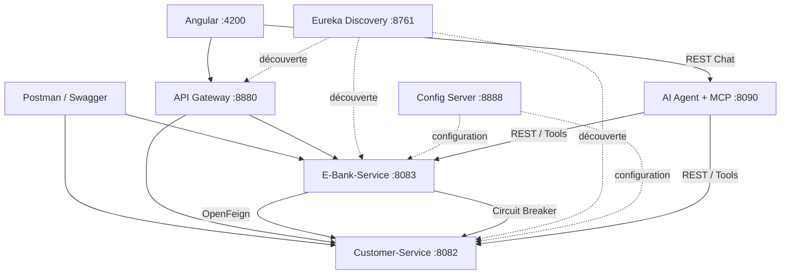

# EBank — Architecture Microservices, Spring Cloud, Spring AI et MCP

Projet pédagogique de mise en œuvre d'une architecture microservices avec Spring Boot, Spring Cloud, OpenFeign, Resilience4j, Eureka, API Gateway, Spring AI, MCP et Angular.

## Guide détaillé

**[Lire le guide complet d'installation, de lancement, de tests et de captures d'écran](docs/guide-demarrage-et-tests.md)**

Le guide contient les commandes Windows PowerShell, l'ordre de démarrage, les requêtes Postman/REST, les vérifications Eureka, les tests du chatbot et une liste de captures à réaliser.

## Architecture générale



## Modules et ports

| Module | Port | Fonction |
|---|---:|---|
| discovery-service | 8761 | Registre Eureka |
| config-server | 8888 | Configuration centralisée (profil native) |
| custumer-service | 8082 | CRUD clients et base H2 |
| e-bank-service | 8083 | Comptes bancaires, OpenFeign et Circuit Breaker |
| api-gateway | 8880 | Routage dynamique via Eureka |
| ai-agent-service | 8090 | Chatbot Spring AI et serveur MCP |
| frontend-angular | 4200 | Interface de discussion Angular |

## Prérequis

- Java 21
- Maven 3.9+
- Node.js LTS et npm
- Une clé API OpenAI pour exécuter le chatbot

## Compilation

Depuis la racine du dépôt :

```powershell
mvn clean verify
```

## Démarrage rapide

Ouvrir un terminal PowerShell par service et exécuter depuis la racine :

```powershell
mvn -pl discovery-service spring-boot:run
mvn -pl config-server spring-boot:run
mvn -pl custumer-service spring-boot:run
mvn -pl e-bank-service spring-boot:run
mvn -pl api-gateway spring-boot:run
```

Pour le chatbot, dans un autre terminal :

```powershell
$env:OPENAI_API_KEY = "VOTRE_CLE_API"
mvn -pl ai-agent-service spring-boot:run
```

Pour Angular :

```powershell
cd frontend-angular
npm install
npm start
```

## Endpoints principaux

- Eureka : http://localhost:8761
- Customer : `GET http://localhost:8082/api/customers`
- Customer par ID : `GET http://localhost:8082/api/customers/1`
- E-Bank via OpenFeign + Circuit Breaker : `GET http://localhost:8083/api/banking/customers/1`
- Comptes : `GET http://localhost:8083/api/accounts`
- Gateway : `GET http://localhost:8880/customer-service/api/customers`
- Chatbot : `POST http://localhost:8090/api/ai/chat` avec `{"message":"Bonjour"}`
- Swagger Customer : http://localhost:8082/swagger-ui/index.html
- Swagger E-Bank : http://localhost:8083/swagger-ui/index.html
- Angular : http://localhost:4200
- Notification Telegram : `POST http://localhost:8090/api/notifications/telegram`
- Notification Discord : `POST http://localhost:8090/api/notifications/discord`

## MCP et outils IA

Le module IA utilise Spring AI et expose les outils de consultation client et de comptes via un fournisseur de callbacks. Le guide détaille les vérifications à effectuer avec un client MCP compatible. L'appel effectif doit être validé dans l'environnement local.

## Captures d'écran

Les captures de démonstration doivent être prises après lancement réel des services. Les noms et emplacements attendus sont listés dans [le guide](docs/guide-demarrage-et-tests.md), dossier `docs/screenshots/`. Aucune capture de fonctionnement n'est présentée comme preuve avant d'avoir été réalisée.

## Notifications Telegram et Discord

Le module IA fournit deux endpoints REST d'envoi. Configurer `TELEGRAM_BOT_TOKEN`, `TELEGRAM_CHAT_ID` et/ou `DISCORD_WEBHOOK_URL` dans l'environnement avant de lancer le service. Les commandes de test sont dans le [guide détaillé](docs/guide-demarrage-et-tests.md).

## Sécurité

- Ne jamais committer de clé API, token Telegram/Discord ou secret.
- Utiliser des variables d'environnement ou un gestionnaire de secrets.
- Masquer les secrets et informations privées sur les captures.

## État actuel

La structure des modules, les endpoints de base, la configuration Spring Cloud, l'interface Angular, les outils IA/MCP et les endpoints de notification Telegram/Discord sont présents. Une exécution GitHub Actions Maven a confirmé `BUILD SUCCESS` pour les modules backend au commit `8ac2e8e`. Les dernières modifications de notification doivent également passer le workflow. Les tests fonctionnels nécessitent un environnement local et des secrets configurés.
